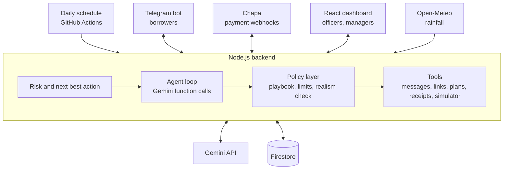

# AI Collections Officer

An AI collections officer that a small lender can hire. It works on three levels:

- **Prevent:** it watches every borrower's payment behaviour, and rainfall in the regions of farming loans, and steps in before a payment is missed. For example, it offers a farmer a schedule that fits the harvest.
- **Recover:** when a borrower is late, it sends payment links, verifies every payment and receipt, negotiates plans within the lender's rules, and refuses plans that would only delay the problem.
- **Steer:** it forecasts cash for the manager, tests policy changes on a simulated copy of the loan book, and works through plain-language requests such as "Farmers in Sidama are struggling; what should we do?"

Gemini decides; code enforces. Every action the model chooses passes a policy layer written in code before a tool runs it, and every decision is recorded with its reasons.

Built for the Brain^3 Level 1 assignment. The solution design is in [`docs/solution-design.pdf`](docs/solution-design.pdf).

## Results

### Stress test: agent compared with plain reminders

The simulator runs the **real agent code** against a few hundred simulated borrowers whose hidden traits the agent cannot see. It compares the agent with a fixed reminder schedule (3 days before, on the day, then every few days). A simulator can only prove what it was built to assume, so each scenario changes one assumption, including one where weather has no effect at all.

Generate the numbers with `npm run simulate -- 200 3` (200 borrowers, 3 runs per scenario). The dashboard's Agent performance page shows the same table.

| Scenario | Collected: reminders | Collected: agent | Loans going bad: reminders | Loans going bad: agent | Agent plans kept |
|---|---|---|---|---|---|
| Weather matters | 96.0% | 97.4% | 9.5% | 8.2% | 49.6% |
| Weather matters a little | 96.4% | 97.6% | 8.8% | 6.0% | 54.5% |
| Weather does not matter | 96.3% | 97.8% | 8.5% | 5.8% | 54.2% |
| Harder borrowers | 89.5% | 94.3% | 22.5% | 12.2% | 46.6% |
| Noisy signals | 96.0% | 97.4% | 9.5% | 7.8% | 47.4% |
| Borrowers pay part unasked | 98.2% | 98.4% | 4.8% | 5.0% | 51.4% |

200 simulated borrowers, 2 runs per scenario, 180 days. "Going bad" = at least half an instalment more than 60 days overdue at the end. The agent also sends more messages per birr collected than plain reminders, within the contact limits.

Where borrowers already pay part of what they owe on their own, most of the agent's advantage disappears: it collects slightly more, with about the same share of loans going bad. Its value is largest with borrowers who struggle or go quiet, which is where a human officer's time goes today.

What the simulator taught us, and what changed in the agent because of it:

1. **Evenly split plans broke.** Borrowers could not afford them. Plans now follow what the borrower says they can pay, and anything beyond the playbook goes to a manager.
2. **Handed-over cases went silent.** A late loan waiting for an officer's call got no messages, so forgetful borrowers never paid. Those cases now get a weekly reminder unless they are on hold for hardship, a dispute or an opt-out.
3. **Early schedule changes moved money only 14 days,** which for most farmers is still before harvest. The agent now asks for the income date and aligns the plan to it.

### Evaluation suite

`npm run eval` scores how well the agent reads borrower replies (English, Amharic and mixed), and checks adversarial replies, receipt checks and tone. It runs in CI on every push (deterministic checks only, so pushes never spend the free Gemini quota). Running the CI workflow by hand also scores Gemini and fails the build below the thresholds (intent 85%, amounts 85%, no false "paid").

| Reader | Intent | Amounts | Dates | False "paid" | English | Amharic | Mixed |
|---|---|---|---|---|---|---|---|
| Rule-based fallback | 75.0% | 100.0% | 83.3% | 0 | 100.0% | 16.7% | 50.0% |
| Gemini (gemini-3.5-flash-lite) | 91.7% | 100.0% | 100.0% | 0 | 94.1% | 83.3% | 100.0% |

Receipt checks 8/8, tone checks 6/6, adversarial replies never marked as paid. The fallback reads English well and Amharic poorly, which is why replies go to Gemini in production. The Gemini row is from a manual CI run on the free tier; a few calls hit temporary 503 "high demand" errors and were answered by the fallback, so it slightly understates the model.

## How it works



**Every morning** the agent syncs the book, reads rainfall for regions with farming loans, scores every loan with plain reasons, picks an action per borrower (wait, remind, check in early, offer a schedule change, negotiate, or hand over), checks it against the playbook, and acts. Between runs it reacts to every reply, payment and receipt.

**Code map**

| Path | What it is |
|---|---|
| `packages/shared` | Zod schemas shared by the API, Gemini output validation and the dashboard |
| `apps/api/src/domain` | Pure logic: risk score, policy layer, negotiation, realism check, next best action, forecast |
| `apps/api/src/agent/service.ts` | The agent: daily cycle, replies, payments, receipts, approvals, decision trace |
| `apps/api/src/agent/manager.ts` | The manager's agent: Gemini function calling over portfolio, sandbox and draft tools |
| `apps/api/src/adapters` | Gemini, Chapa, Telegram, Open-Meteo, Firestore, plus local stand-ins for each |
| `apps/api/src/sim` | Borrower simulator, stress-test scenarios, policy sandbox |
| `apps/api/src/evals` | Labelled evaluation set and runner |
| `apps/web` | React dashboard |

**Safety, enforced in code:** quiet hours, a daily contact cap, opt-out on "stop", a tone check on every generated message, playbook limits and the realism check on every plan, payments recorded once and verified with the gateway, borrower text and receipt images treated as data, never instructions. Regional and weather signals can only trigger help, never harsher treatment.

## Run it locally

Needs Node.js 20 or later. No accounts are needed: every external service falls back to a local stand-in (templates instead of Gemini, a local checkout page instead of Chapa, an outbox instead of Telegram).

```bash
npm install
npm run build -w packages/shared
npm run dev:api                                # API on :8080, demo data seeded
VITE_AUTH_MODE=demo npm run dev:web            # dashboard on :5173, no sign-in
```

Copy `.env.example` to `.env` to add real keys.

```bash
npm test            # unit and agent tests
npm run eval        # evaluation suite
npm run simulate    # stress test
```

## Deploy

The assignment suggests Google Cloud's free tier. Cloud Run and Cloud Scheduler require a billing account with a card, which was not available, so the same code runs on free services that need no card:

| Piece | Where it runs |
|---|---|
| API and dashboard | Render free web service (`render.yaml`) |
| Daily cycle | GitHub Actions schedule (`.github/workflows/daily-cycle.yml`) |
| Database, sign-in | Firebase Firestore and Authentication, free Spark plan |
| AI | Gemini API, free key from Google AI Studio |

The backend is a plain Node server, so it moves to Cloud Run unchanged once billing is available.

Secrets are set in Render and GitHub, never in the repository: `GEMINI_API_KEY`, `CHAPA_SECRET_KEY`, `TELEGRAM_BOT_TOKEN`, `TELEGRAM_WEBHOOK_SECRET`, `FIREBASE_SERVICE_ACCOUNT`, `CRON_SECRET`. The Telegram webhook is registered automatically on start.

## Honest limits

- The simulator's borrowers are invented. The stress test shows which parts of the agent carry the result under different assumptions; it is not a forecast for a real lender.
- The risk weights start hand-set. `fitWeights` refits them to a lender's own outcomes once there is history.
- Rainfall for Sidama and South Ethiopia uses labelled demo values so the dry-season story shows whatever the real season is; other regions use live Open-Meteo data.
- Telegram is the only borrower channel in this build; Chapa runs in test mode.

## Roadmap

Learning which message versions work best, a reviewer agent for sensitive messages, group loans and guarantors with consent, crop-price signals, funder and regulator reports, WhatsApp and voice notes, more payment providers, field-visit routes.

## License

MIT
